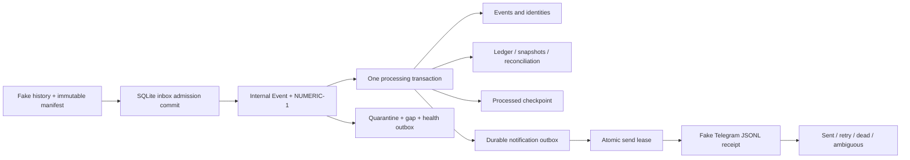

# Kiến trúc và hợp đồng Offline Core

## Luồng xử lý

Không import HTTP/WebSocket/SDK Binance/Telegram. `EventSource` và `Notifier` là Protocol để thay adapter ở giai đoạn sau. `Engine` nhận Store làm boundary; việc chuyển PostgreSQL cần repository/transaction implementation mới, không phải đổi connection string SQLite. Không nhúng SQL SUM/REAL cho tiền.

## NUMERIC-1

`core/numeric.py` là implementation sản phẩm, không import checker của tài liệu. Input chỉ chuỗi ASCII có bounds đúng Skill; finite check trước so sánh; reject kiểu float/bool/int, không zero-fill. Context mới/local precision128, traps Inexact/Rounded và các lỗi khác, không làm tròn ledger. Sum dùng Aggregate có leaf count; truy xuất projection đếm lại các dòng ledger bền vững và baseline, không reset count khi restart. Serialize fixed-point không dùng normalize/global context; deserialize aggregate có bounds riêng. Ratio quyết định HALF_EVEN từ thương/dư chính xác, display có metadata rounding riêng.

Timeout/pacing của OS có thể dùng số thực theo đơn vị thời gian; không có phép tính tiền tệ qua float. Unit tests cố tình truyền float để xác nhận từ chối. SQL SUM chỉ dùng cho **số lần thử dạng INTEGER**, không dùng cho amount.

## Internal event v1

Tham khảo fixture JSON. Bắt buộc: `source`, `source_event_id`, `id_trusted: true`, account alias, wallet, asset, amount chuỗi, event_type, event_time/received_time có timezone, status, version integer, schema_version1, metadata object, evidence không rỗng. Các timestamp chuẩn hóa UTC; fake notification có thêm GMT+7 bằng offset cố định+07:00, không cần tzdata ngoài Python trên Windows.

Wallet: SPOT/FUTURES/FUNDING; asset giữ nguyên, không quy đổi hoặc cộng nhiều asset. Types: BALANCE_SNAPSHOT, DEPOSIT, WITHDRAWAL, INTERNAL_TRANSFER, REALIZED_PNL, UNREALIZED_PNL_SNAPSHOT, TRADING_FEE, FUNDING_FEE, ACCOUNT_ADJUSTMENT, thêm WITHDRAWAL_FEE để không trộn phí rút với commission.

Đây là dữ liệu **đã phân loại có bằng chứng** từ nguồn tổng hợp. Không suy ra deposit từ wallet delta. Chưa có raw Binance mapper, order/fill/position projection hoặc Bot4 receiver. ID phải duy nhất trong namespace source/account/wallet/asset/type; ID chỉ duy nhất theo symbol phải được adapter đã xác minh qualify trước, ví dụ `BTCUSDT:trade-123`. `id_trusted` là cam kết internal source, không chứng minh ID Binance thật đã được xác minh.

Metadata allowlist: `to_wallet`, `metric`, `opening`, `reverses`, `economic_id`, `correlation_evidence`, `network`. Unknown keys bị redacted và vẫn tạo marker để validation không nhận nhầm dữ liệu đã sửa. Không lưu field secret/token/URL ký trong raw metadata. Allowed fields chỉ được chứa dữ liệu đúng mục đích, không credentials. Log formatter chỉ xuất action/code/IDs do chương trình kiểm soát; không message tự do hoặc exception raw.

## Identity, trạng thái và source correlation

- Identity gồm source/account/wallet/asset/type/source_event_id, không dùng timestamp đơn lẻ. Cùng identity có fingerprint tài chính gồm amount, event time, wallet/destination/asset/type và metadata tài chính. Fingerprint mâu thuẫn → quarantine, giữ ledger cũ, không bỏ qua im lặng.
- Status `pending` ghi observation, không cashflow. `completed` hạch toán một lần. `failed`/`cancelled` không hạch toán. Version tăng được chuyển pending→terminal; version cũ không làm lùi trạng thái. Terminal không được đổi sang trạng thái khác; phải dùng correction riêng. Cùng version khác status là lỗi.
- Một event source có nhiều phiên bản/audit event_id nội bộ. `economic_events` UNIQUE chống posting lặp kể cả completed version cao hơn hoặc nguồn khác. Outbox key theo economic key, không enqueue lại chỉ vì một delivery trùng.
- Cross-source chỉ gộp với economic_id và correlation_evidence rõ ràng, fingerprint phải khớp. Nguồn secondary không có canonical record trước đó bị quarantine; khi primary đến, replay lại có thể đóng gap. Không tự chứng minh correlation bằng amount/time giống nhau.
- Không có ID tin cậy → quarantine chờ xác minh, không tự phát minh timestamp fingerprint. Không có source mapper live; future adapter phải kiểm chứng ID/key scope trước.

## Baseline, ledger và correction

Baseline là BALANCE_SNAPSHOT có `opening: true`, metric wallet, một lần cho mỗi account/wallet/asset. Cutoff bao gồm mọi dòng tiền có event_time≤cutoff; replay lịch sử trước cutoff chỉ lưu observation, không cộng lại vào ledger. Không cho mở baseline mới để che ledger đã ghi trước cutoff. Không có baseline thì ledger có thể lưu dòng tiền có bằng chứng nhưng projection trả null/MISSING_OPENING, không giả0.

Một transfer đã chuẩn hóa phải có ví đích; hai chân ghi trong **cùng transaction**, không có trạng thái chân lẻ bên trong core. Việc ghép hai chân raw đến chậm là trách nhiệm adapter tương lai và chưa kiểm thử. DEPOSIT/WITHDRAWAL/TRANSFER amount dương, withdrawal tạo debit; fee riêng là signed amount, không tự suy gross/net. PnL/commission/funding/adjustment dùng dấu nguồn đã chuẩn hóa. Snapshot, available/margin/initial margin và unrealized không tạo bút toán. Metric update riêng không xóa metric vắng; latest xét event_time, snapshot cùng metric/time nhưng amount khác bị quarantine.

Projection = baseline + ledger sau cutoff, theo đúng wallet/asset. Reconciliation so observed wallet snapshot với projection **as-of snapshot event_time**, không với tổng hiện tại; late event tính lại được. Residual khác0 → UNKNOWN_BALANCE_CHANGE, không tự tạo adjustment. Tổng capital/transfer/PnL/fee trả theo wallet/asset/category, có net/credits/debits; không đồng nhất net internal transfer với deposit bên ngoài.

Mismatch mới làm mất chứng nhận complete của recovery window/checkpoint. Alert chứa scope, observed/expected/residual và snapshot time; các chuyển trạng thái được version hóa bền vững trong cùng transaction, gồm RECONCILIATION_RESOLVED khi dữ liệu muộn giải thích được gap. Replay không gửi lại cùng transition. Thiếu baseline được hiển thị thành gap ngay cả khi chưa có observed snapshot.

Correction: event ACCOUNT_ADJUSTMENT, status correction, metadata.reverses là **internal event_id đã post**, amount bằng âm amount gốc, cùng scope và event time không trước bản gốc. Tạo postings ngược, không UPDATE/DELETE lịch sử. Mỗi target chỉ reverse một lần; duplicate correction không ghi lại. Ledger reversal giữ category bút toán gốc để summary net của deposit/PnL/fee được hiệu chỉnh, còn event vẫn là ACCOUNT_ADJUSTMENT cùng bảng reversals truy vết. Transfer reversal đảo cả hai chân. Không hỗ trợ sửa baseline hoặc đảo giao dịch trước baseline đã không có posting; phải thiết kế quy trình kỳ/baseline riêng có review.

## SQLite, checkpoint và recovery

Initial migration v1 dùng transaction tạo bảng và PRAGMA user_version1; version lạ bị từ chối, không downgrade. WAL, synchronous FULL, foreign keys, BEGIN IMMEDIATE. Admission commit inbox trước xử lý; processing commit chung event/identity/economic/ledger/snapshot/reconciliation/outbox/checkpoint. Fault hook trước/sau commit có tests. OperationalError locked/busy trở thành DatabaseBusy để caller retry; lỗi khác rollback, inbox pending; không quarantine lỗi hạ tầng thành lỗi dữ liệu.

`processed_offset` chỉ là cursor **journal fake nội bộ** có offsets liên tục1..N, không phải sequence ID Binance. Nó tiến qua các inbox active đã processed theo thứ tự liên tục; không vượt bản ghi quarantined/missing. `complete_offset` chỉ được chứng nhận khi manifest đầy đủ, không quarantine và snapshots đối soát phủ ledger; gap mới làm mất chứng nhận complete. Một cursor đã đọc không đồng nghĩa lịch sử tài chính đã đối soát.

Fake source có manifest hash theo offset; phát hiện thiếu/corrupt/substituted record cả khi hai khoản+5/−5 bị thiếu mà net snapshot không đổi. Đây không phải bằng chứng Binance cung cấp manifest tương tự. Recovery replay toàn history nhỏ và inbox pending; không cố tối ưu polling/retention chưa xác minh. Window incomplete nếu thiếu record, mismatch, quarantine, thiếu baseline hoặc residual; không báo full sync từ reconnect đơn thuần. Complete của fake chỉ trong phạm vi manifest internal hiện có, không là tuyên bố toàn bộ lịch sử tài khoản Binance.

`replace_quarantined` append revision, giữ payload cũ. Quarantine chỉ đóng sau processing thành công. Nếu manifest cũ chứa record lỗi thì vẫn incomplete; operator phải gọi `Recovery.accept_manifest_revision` với evidence sau khi replacement đã processed, lưu hash cũ/mới và lý do. Không tự sửa manifest để test qua. SOURCE_OFFSET_CONFLICT trên record đã commit không tự resolve; cần điều tra/review nguồn, không ghi đè event cũ.

`Store.backup` dùng SQLite backup API, kiểm integrity; restore vào file riêng rồi replay overlap đã được test. Không có backup scheduler, disk retention policy hoặc RPO/RTO vận hành đã chứng minh. DB bị khóa cần retry ở caller; chưa có service supervisor tự động.

## Fake notifier và health

Outbox commit trước send, unique logical key, claim lease/attempt count trong transaction riêng. Fake Telegram ghi memory hoặc JSONL đã fsync. Transient/rate-limit retry có exponential backoff và retry_after, tối đa5 attempts; permanent thành dead. Ack mất/transport ambiguous hoặc lease hết hạn → ambiguous và dừng tự retry. Chưa có operator requeue/ack UI; không tuyên bố exactly-once. Ack thành công lưu receipt/ack_at, retry lịch theo response time. Không render Telegram Markdown/HTML ở giai đoạn này; fake payload là JSON, không nhận chat đích từ event.

Health trả DB quick_check, processed/pending, unique error/quarantine, reconciliation/history gap, outbox statuses/retries, latest received time, heartbeat age từ commit và processing lag. Fixture received times có thể là lịch sử nên lag lớn là tuổi dữ liệu replay; không diễn giải là mất kết nối. Chưa có process heartbeat loop/watchdog độc lập, low-balance policy, cooldown/jitter production, periodic VPS exporter hoặc24h soak.
